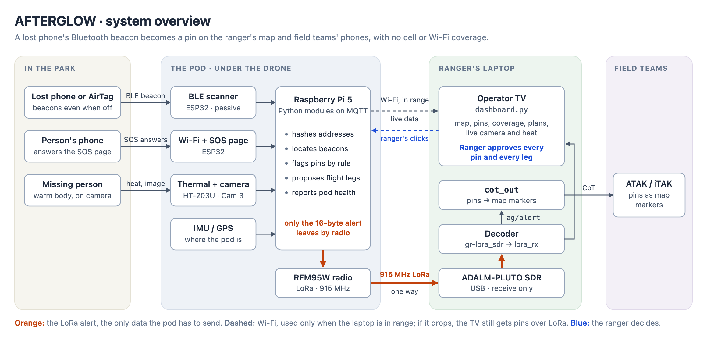
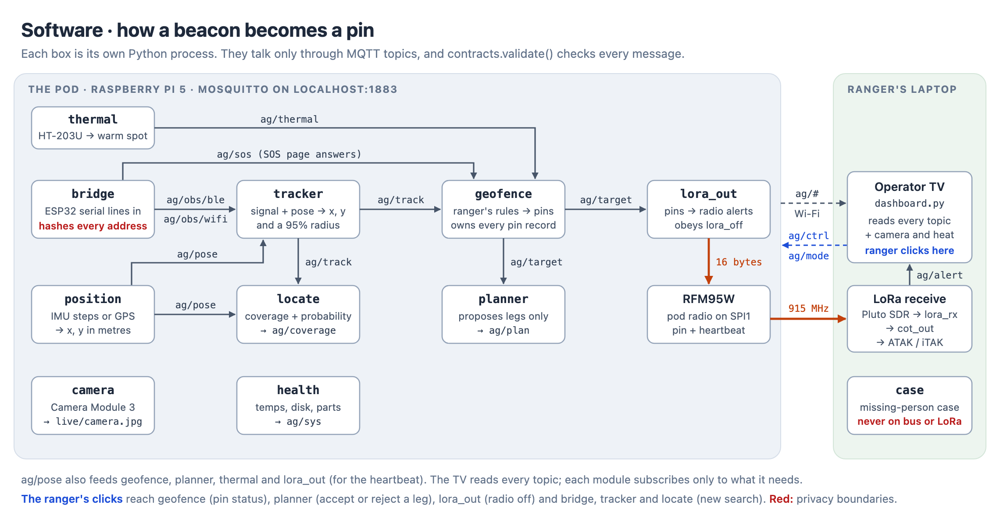
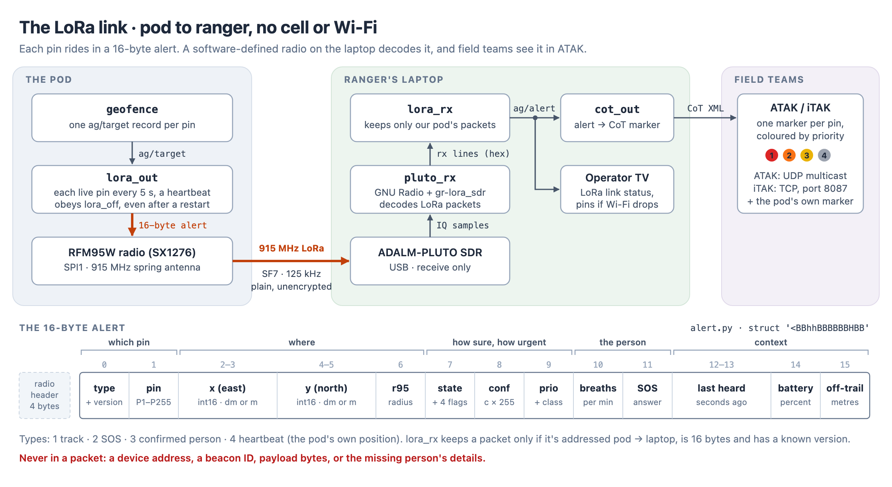
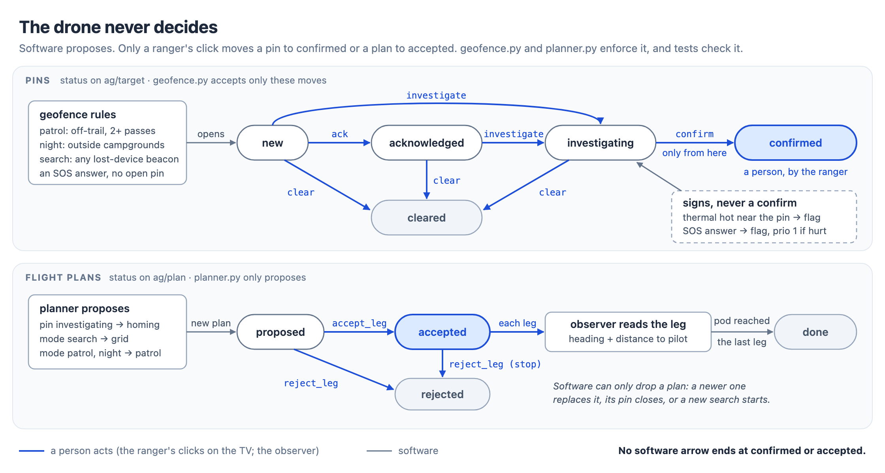
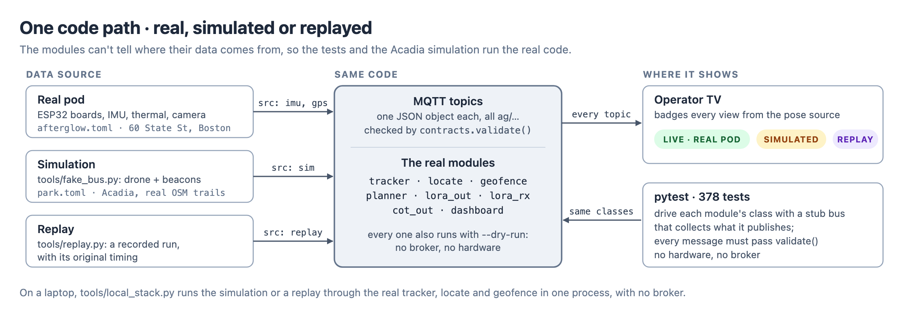
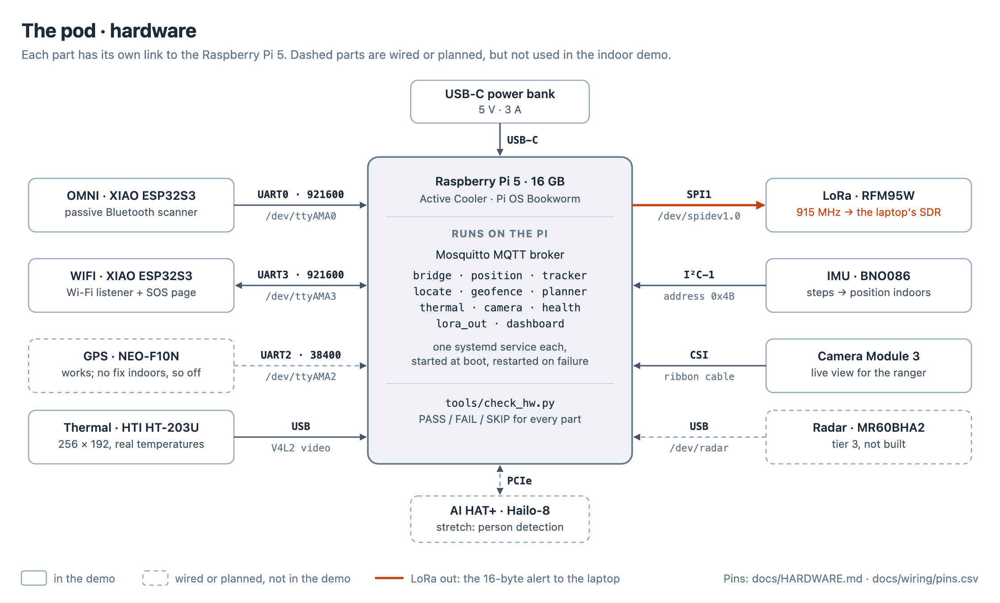

<div align="center">

# AFTERGLOW

**A drone payload that finds lost phones, even switched-off or dead ones, so park rangers can find the people who carried them.**

Built in 26 hours by Team 30 at the CodeMetalForge Hackathon, 7–8 Nov 2026.


</div>

> **The one rule: the drone never decides.** The software proposes; a human ranger approves every pin and every flight leg. No code path can confirm a pin or accept a leg on its own.

---

## Contents

- [The problem](#the-problem)
- [The idea](#the-idea)
- [Demo videos](#demo-videos)
- [What it does](#what-it-does)
- [How it works](#how-it-works)
- [Hardware](#hardware)
- [Safety and privacy by design](#safety-and-privacy-by-design)
- [What's real and what's simulated](#whats-real-and-whats-simulated)
- [Try it on a laptop (no hardware)](#try-it-on-a-laptop-no-hardware)
- [Repository layout](#repository-layout)
- [Documentation](#documentation)
- [What's next](#whats-next)
- [Team](#team)
- [License](#license)

---

## The problem

When someone goes missing in a park, rangers have to narrow a huge area down to one spot, fast. In an Oregon study of about 3,300 search subjects, **search time was the only factor that predicted survival** ([Adams et al. 2007](<https://www.wemjournal.org/article/S1080-6032(07)70218-1/fulltext>)).

The lost person's phone is often the best clue. But by the time a search starts, the phone is usually out of coverage, out of battery or switched off, and existing drone tools only find phones that are still on.

## The idea

Modern phones keep calling for help after they go quiet:

- An **iPhone 11 or newer** keeps sending an Apple Find My Bluetooth beacon for **up to 24 hours after it is switched off**, and for **about 5 hours after its battery dies** ([Macworld](https://www.macworld.com/article/2154248/how-to-find-a-missing-iphone-or-ipad-when-its-nearly-out-of-power.html)).
- **Android** phones in Google Find Hub or Samsung lost mode do something similar, and so do AirTags.

AFTERGLOW is a sensing pod that straps under a drone and listens for those beacons. It pins each one on the park map and sends the pin to the ranger over long-range radio (LoRa), with **no cell service or Wi-Fi needed**. Live camera and thermal views then help the ranger confirm that there's a person at the pin.

## Demo videos

| Video | What it shows |
|---|---|
| [TAK and Dashboard Demo](docs/demo%20videos/TAK%20and%20Dashboard%20Demo.mp4) | End to end: pins on the operator dashboard and on field teams' phones (iTAK) |
| [Active Search Case](docs/demo%20videos/Active%20Search%20Case.mp4) | A full missing-person search, from sweep to found person to rescue route |
| [Regular Pathfinding Demo](docs/demo%20videos/Regular%20Pathfinding%20Demo.mp4) | The planner proposing patrol and homing legs for the ranger to approve |
| [All Signals Video](docs/demo%20videos/All%20Signals%20Video.mp4) | The close-range view of every beacon the pod hears |
| [Functioning Cameras](docs/demo%20videos/Functioning%20Cameras.mov) | The live camera and the thermal camera working on the pod |

> The larger videos are too big for GitHub's in-browser player. Click **View raw** to download them.

## What it does

1. **Hears.** A passive Bluetooth scanner picks out lost-device beacons (Apple Find My, Google Find Hub, Samsung lost mode). It reads only each beacon's type marker and signal strength, never its contents.
2. **Locates.** A tracker combines signal strength with where the pod was to estimate each beacon's position, with an honest 95% confidence radius. It keeps following a beacon even when the beacon's key rotates.
3. **Flags.** The ranger's rules decide which beacons become pins:
   - **Day patrol:** a beacon farther off-trail than a set distance, heard on 2 or more passes.
   - **Night sweep:** any beacon outside the campgrounds.
   - **Active search:** every lost-device beacon.
4. **Sends.** Each pin leaves the pod as a **16-byte LoRa alert**. A software-defined radio on the ranger's laptop receives it, and the pin appears on the operator screen and on field teams' phones (ATAK/iTAK).
5. **Helps confirm.** The ranger checks each pin with a live camera view and real thermal temperatures. An **SOS Wi-Fi page** lets the lost person answer "hurt? can walk? how many?", and each answer lands on the pin.
6. **Plans.** The planner proposes homing passes, a search grid or a trail patrol. Once the ranger accepts a leg, an observer reads its heading and distance to the pilot.

## How it works



- **On the pod:** each part is its own Python process on a Raspberry Pi 5, and they talk over MQTT topics. Only the 16-byte alert leaves the pod over LoRa.
- **Over the air:** pod RFM95W → 915 MHz LoRa → ADALM-PLUTO SDR on the laptop (GNU Radio + gr-lora_sdr) → operator dashboard → Cursor-on-Target markers for ATAK/iTAK.
- **Over Wi-Fi (when in range):** the laptop dashboard also reads the pod's MQTT broker for live pictures, tracks and coverage.
- **Contracts:** every message format is defined in [`docs/CONTRACTS.md`](docs/CONTRACTS.md) and checked by `contracts.validate()` in the tests.

<details>
<summary><b>Software data flow: how a beacon becomes a pin</b></summary>



| Module | Runs on | Reads | Writes |
|---|---|---|---|
| `bridge` | pod | ESP32 serial lines | `ag/obs/ble`, `ag/obs/wifi`, `ag/sos` (addresses hashed) |
| `position` | pod | GPS NMEA, IMU or waypoints | `ag/pose` |
| `tracker` | pod | `ag/obs/*`, `ag/pose` | `ag/track`, `ag/pass` |
| `locate` | pod | `ag/pose`, `ag/track` | `ag/coverage` (coverage and probability grids) |
| `geofence` | pod | `ag/track`, map, `ag/mode`, `ag/sos` | `ag/target` (one record per pin) |
| `planner` | pod | `ag/target`, `ag/pose`, `ag/mode` | `ag/plan` (proposals only) |
| `thermal`, `camera` | pod | HT-203U, Camera Module 3 | live images, `ag/thermal` |
| `health` | pod | Pi temperature, throttling, disk | `ag/sys` |
| `lora_out` | pod | `ag/target`, `ag/pose`, `ag/sys` | 16-byte LoRa alerts + heartbeat |
| `lora_rx` | laptop | Pluto SDR receiver lines | `ag/alert` |
| `cot_out` | laptop | `ag/alert` | CoT XML for ATAK (UDP) and iTAK (TCP) |
| `dashboard` | laptop | everything | the operator TV; relays the ranger's clicks |

</details>

<details>
<summary><b>The LoRa link and the 16-byte alert</b></summary>



</details>

<details>
<summary><b>The drone never decides</b></summary>



</details>

<details>
<summary><b>Real, simulated or replayed: one pipeline</b></summary>



</details>

## Hardware

<table>
<tr>
<td width="50%"></td>
<td width="50%"></td>
</tr>
</table>

| Part | Job | Connects via |
|---|---|---|
| Raspberry Pi 5 (16 GB) + Active Cooler | Runs every pod service | — |
| 2× Seeed XIAO ESP32-S3 | Passive Bluetooth scanner; Wi-Fi listener + SOS page | UART |
| Adafruit RFM95W (SX1276) | 915 MHz LoRa transmitter | SPI1 |
| ADALM-PLUTO SDR | LoRa receiver on the ranger's laptop | USB |
| HTI HT-203U | Thermal camera (real temperatures from raw 16-bit frames) | USB (V4L2) |
| Raspberry Pi Camera Module 3 | Live view | CSI |
| SparkFun BNO086 | IMU (step counting for the indoor demo) | I²C |
| SparkFun NEO-F10N + ANN-MB5 | GPS | UART |
| Raspberry Pi AI HAT+ (Hailo-8) | Reserved for person detection (stretch goal) | PCIe |
| USB-C power bank, 5 V 3 A | Power | USB-C |

Full pin map, setup steps and gotchas: [`docs/HARDWARE.md`](docs/HARDWARE.md). Wiring diagram: [`docs/wiring/wiring_diagram.png`](docs/wiring/wiring_diagram.png).

> **Payload only.** The drones available at the hackathon were too small to carry the pod, so we built and tested the payload on its own. It's designed to strap under a larger drone.

## Safety and privacy by design

- **The ranger decides everything.** A pin can only be confirmed by a ranger's click, the planner only proposes, and the dashboard only relays clicks. Tests cover each of these.
- **Passive listening only.** The scanners never transmit. The only transmitters are the LoRa alert and the SOS page. Both have off switches, and the pilot's control link always wins.
- **No identities.** Raw Bluetooth and Wi-Fi addresses are replaced with a salted hash, with a new salt for every search. Beacon payloads are never decoded, and addresses are never written to disk, a log or the screen.
- **Minimal radio content.** The LoRa alert carries a pin's position, class and status. It never carries an address or ID.
- **The case stays home.** The missing person's details (name, age, description) stay on the ranger's laptop and never go over the radio.

## What's real and what's simulated

| Part | Status | Evidence |
|---|---|---|
| Bluetooth scanner | ✅ On hardware | Real Find My beacons reach the bus as hashed IDs. In a crowded building it picked out about 1.5 Find My beacons/s from about 240/s of other Apple traffic. |
| LoRa link, pod → laptop | ✅ On hardware | Pins and heartbeats received on the Pluto SDR. Packets from 6 other teams were heard and filtered out. |
| Thermal camera | ✅ On hardware | Reads real temperatures: a hand 50 cm away reads hot, a wall doesn't. |
| Live camera | ✅ On hardware | Live view on the dashboard. |
| SOS Wi-Fi page | ✅ On hardware | A phone joins `SOS-RESCUE`, the page pops up, and the answer reaches the ranger. |
| Wi-Fi listener | ✅ On hardware | Hashed probe IDs on channels 1, 6 and 11. |
| Pod services | ✅ On hardware | All 9 pod modules start at boot under systemd, with a health monitor. |
| Position | ✅ On hardware | GPS sends NMEA but gets no fix indoors; the indoor demo uses IMU step counting. |
| Tracking accuracy | 🟡 Simulated | Real tracker on simulated beacons, 20 runs indoors: worst error 1.5 m. Not yet measured with real beacons. |
| Park-scale mission (Acadia) | 🟡 Simulated | A full mission on real OpenStreetMap trails, badged SIMULATED on screen. |
| ATAK / iTAK markers | 🟡 Built and tested in code | Cursor-on-Target markers plus a small TAK server for iTAK. |
| Flight | ⬜ Not flown | Payload only. |
| Person detection (AI HAT+) | ⬜ Stretch goal, not built | The live camera lets a human check instead. |

## Try it on a laptop (no hardware)

You need Python 3.11 or newer.

```bash
cd code
python3 -m venv .venv && .venv/bin/pip install -r requirements-laptop.txt
.venv/bin/python -m pytest -q                                      # 379 tests
.venv/bin/python tools/local_stack.py --config park.toml --feeds   # the whole system, simulated
```

Open **http://localhost:8081** and click **Send out**. The drone sweeps an area of Acadia National Park. About a minute later a false signal pings, and a minute after that, the missing person's phone. Walk it through **Investigate → Confirm**, and accept or reject the legs the planner proposes.

Run the whole LoRa path with no radio and no broker:

```bash
.venv/bin/python tools/fake_bus.py --print --duration 120 | .venv/bin/python -m afterglow.lora_out --dry-run \
  | .venv/bin/python -m afterglow.lora_rx --dry-run | .venv/bin/python -m afterglow.cot_out --dry-run
```

**Mission simulator:** [`simulator/`](simulator/) is a separate browser simulation of whole missions in nine real parks, including two replayed real-world rescue cases:

```bash
cd simulator && python -m http.server 8765    # then open http://localhost:8765
```

**On the real pod:** see [`docs/HARDWARE.md`](docs/HARDWARE.md) for Pi setup and [`docs/DEMO.md`](docs/DEMO.md) for the live-demo runbook.

## Repository layout

```
code/
  afterglow/          one Python module per process (python -m afterglow.<name>)
    pod:              bridge, position, tracker, locate, geofence, planner, thermal, camera, health, lora_out
    laptop:           lora_rx, cot_out, dashboard, case
    web/              the operator TV (Preact + htm, MapLibre; vendored, no CDN, no build step)
  afterglow.toml      live indoor demo profile
  park.toml           Acadia National Park simulation profile
  data/               map data (GeoJSON)
  tools/              fake_bus, local_stack, replay, check_hw (on the Pi), pluto_rx (SDR receiver)
  tests/              pytest
firmware/             ESP32 sketches: Bluetooth scanner, Wi-Fi listener + SOS page
pi/                   Pi setup script, udev rules, Mosquitto config, systemd unit
tak/                  ATAK/iTAK add-on: field teams' phones <-> the operator TV
simulator/            TrailSAR: browser simulation of whole missions in real parks
docs/                 contracts, hardware, diagrams, demo runbook, wiring, photos, videos
```

## Documentation

| Doc | What's in it |
|---|---|
| [`docs/CONTRACTS.md`](docs/CONTRACTS.md) | Every MQTT topic, JSON shape, serial line, the 16-byte LoRa alert and the ATAK mapping |
| [`docs/HARDWARE.md`](docs/HARDWARE.md) | Parts, pin map, Pi setup and known gotchas |
| [`docs/MODULES.md`](docs/MODULES.md) | Module owners, tiers and integration checkpoints |
| [`docs/TV.md`](docs/TV.md) | The operator TV dashboard |
| [`docs/LIVEMAP.md`](docs/LIVEMAP.md) | The 3D live map |
| [`docs/DEMO.md`](docs/DEMO.md) | The live-demo runbook |
| [`docs/diagrams/`](docs/diagrams/) | Block diagrams (SVG + PNG) |
| [`tak/README.md`](tak/README.md) | The TAK integration |
| [`simulator/README.md`](simulator/README.md) | The mission simulator |
| [`docs/drone_build_plan.md`](docs/drone_build_plan.md) | The original build plan (its parts list is out of date) |

## What's next

- **Fly it.** Strap it under a larger drone, then add an autopilot (INAV or ArduPilot) that flies the planner's legs, still with one ranger approval per leg.
- **Measure.** Run range tests and blind passes with real beacons to tune the signal model.
- **Person detection** on the AI HAT+, to point the ranger at likely people in the camera view.
- **More drones on one map.** The message formats already carry a `drone` field.
- **Trailhead Bluetooth tags** for children who don't carry a phone.

## Team

**Team 30:** Dillon Smith, Rohan Sarkar, Birinder Bachhal, Lucas Marotta.

> This is a public mirror of the team's hackathon repository, published as a portfolio snapshot.

## License

Apache 2.0. See [`LICENSE`](LICENSE). Map data © OpenStreetMap contributors (ODbL).
