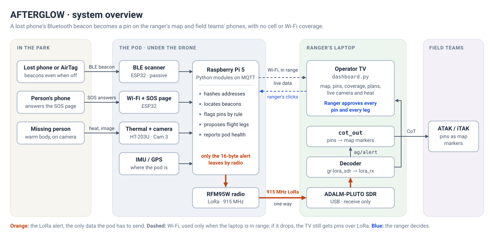
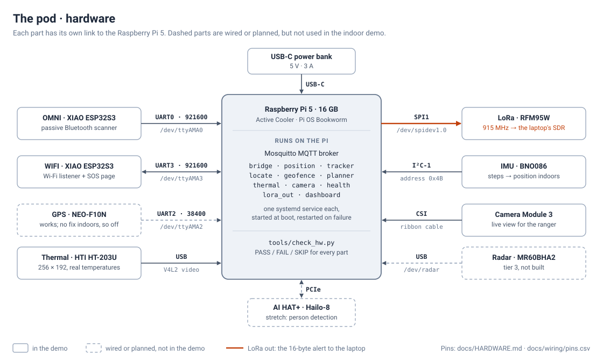
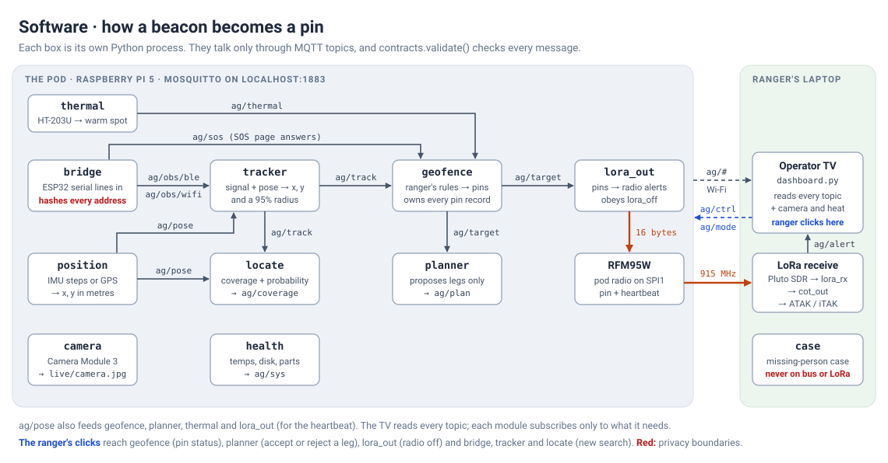
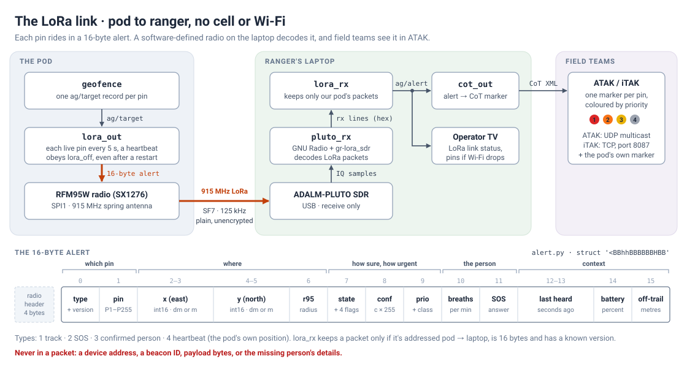
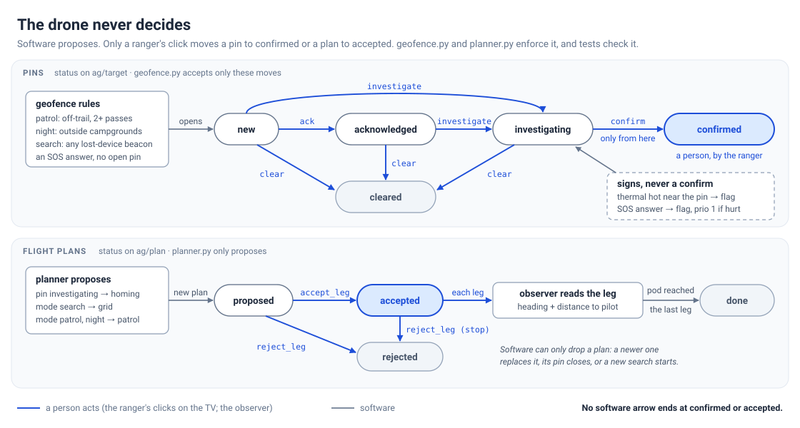
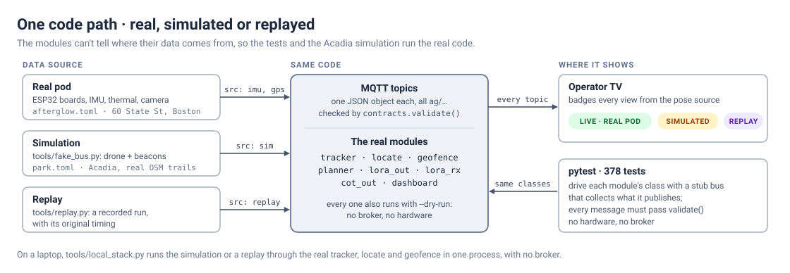

# Diagrams

Block diagrams of AFTERGLOW. The SVGs are the source; `png/` has 2× copies for slides. To redraw a PNG after editing an SVG, render it with headless Chrome at the SVG's own width and height and `--force-device-scale-factor=2`.

## 1. System overview

A lost phone's beacon goes from the park, through the pod, over LoRa to the ranger's laptop, and on to field teams' phones.

## 2. Pod hardware

Every part and the link it uses to reach the Raspberry Pi 5. Pin-level detail is in [`../HARDWARE.md`](../HARDWARE.md).

## 3. Software: how a beacon becomes a pin

The pod's modules and the MQTT topics between them. Message formats are in [`../CONTRACTS.md`](../CONTRACTS.md).

## 4. The LoRa link and the 16-byte alert

The path from `geofence` to ATAK with no cell or Wi-Fi, and what's inside each alert.

## 5. The drone never decides

The pin and plan state machines. Only the ranger's clicks reach `confirmed` or `accepted`.

## 6. One code path: real, simulated or replayed

The same modules run on the real pod, the Acadia simulation and recorded runs, and the tests drive the same classes.

