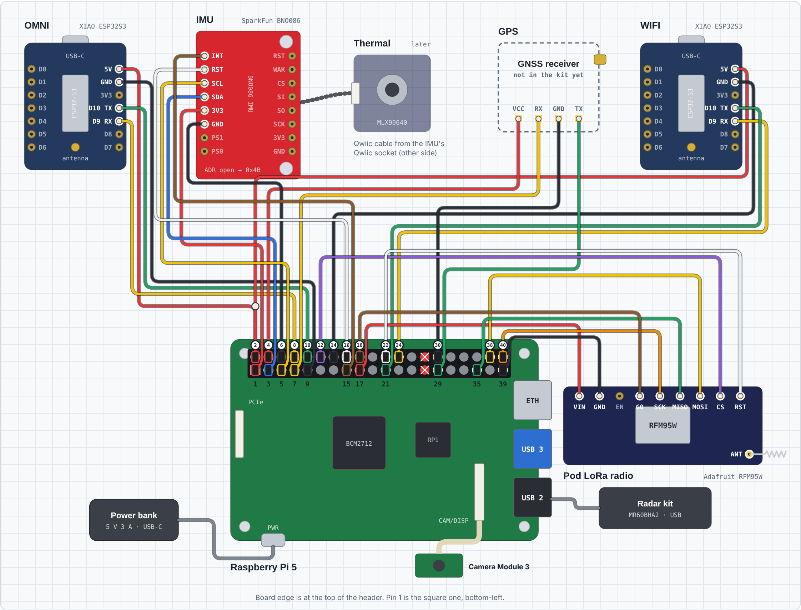
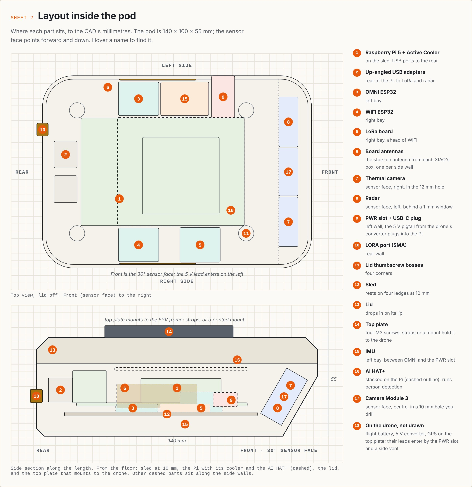
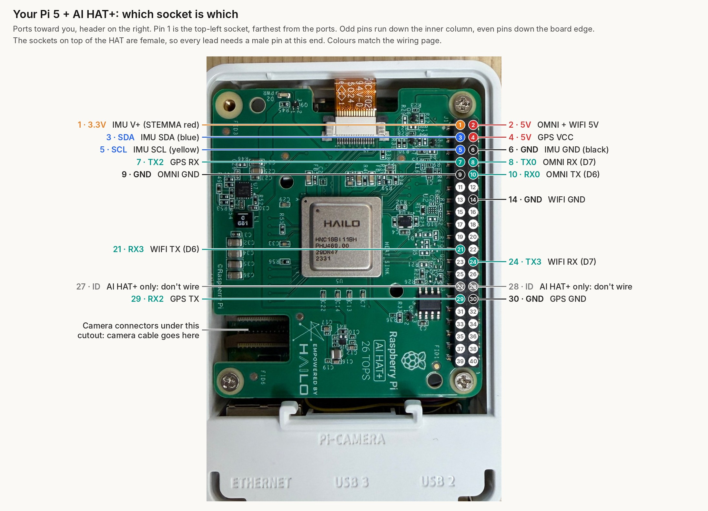

> Offline copy of the "Drone build plan (Nov 7)" tab of the build doc, exported Sat 7 Nov 2026 at hour 0. The live doc wins if they differ.
>
> **Hardware is out of date here (updated Nov 7, hour 2).** The parts we actually got are in `docs/HARDWARE.md`, taken from Rohan's hardware reference (`docs/AFTERGLOW Hardware.pdf`):
> - the LoRa link is the pod's bare RFM95W (on the Pi's SPI1) to an ADALM-PLUTO SDR on the laptop (we have only one RFM95W), with no Meshtastic;
> - the IMU is a BNO086 at `0x4B`;
> - there's no GPS receiver, only an antenna;
> - the XIAOs talk on D9/D10;
> - the pod runs on a 3 A power bank.
>
> Decisions, schedule and the demo script below still stand.

# Drone build plan: from idea to working prototype

Nov 7, 2026 · @Birinder Bachhal

## What we're building

A search pod carried by an FPV drone. It hears the Bluetooth beacons that lost phones and AirTags send, pins where they are, and hands the pin to a ranger. The ranger confirms with the camera, thermal and radar before anyone deploys. This tab replaces the V1 hand-carried plan in the other two tabs wherever they disagree.

**Problem statement** (from Chris's handoff): park rangers and SAR incident commanders need to narrow a search from a whole drainage to one spot within the first few hours. Survival odds fall as search time grows, crews are thin, and the lost person often can't or won't call for help.

**Primary user:** the ranger or SAR incident commander, not the hiker. Call it a *patrol* or *search-assist* system, never surveillance: the pod reads anonymous beacons, not identities.

**Where it flies:** public lands. National parks ban drones unless the park runs its own program, as Grand Canyon does. National forests outside designated wilderness are the easier first pilot.

| Mode | Who flies | What it flags |
| --- | --- | --- |
| Day patrol | The planner's route along published trails, flown by the pilot | A beacon farther off-trail than the rangers' set distance, seen on 2 or more passes |
| Night sweep | The planner's route after closing, flown by the pilot | Any beacon outside campgrounds and permitted camp zones |
| Investigate | Ranger, manual | Flies to a pin. The planner proposes homing passes; the camera and thermal confirm; the radar reads breathing only if landed within 1.5 m; the SOS Wi-Fi page tells the person help is coming |
| Active search | Ranger, manual, after a missing-person report | A grid over the most likely area, spaced by the measured range. The only mode allowed over designated wilderness |

**The one rule:** the drone never decides. The planner proposes; the ranger approves every pin and every leg.

## Decisions locked

These are settled. Change one only as a team, and update this table when you do.

| Topic | Decision | Why |
| --- | --- | --- |
| Platform | The library's FPV drone (model to confirm at the claim) | Colorado teams already fly drones with dedicated pilots, so the pod adds a sensor without loading ground searchers |
| Homing | Software only. **No patch antenna** | A crossing pass and a low orbit find the signal peak; no extra board or antenna |
| Position | **A GPS module on the pod's UART2** (u-blox M10 class, about 10 g), mounted on the drone's top plate. Indoors, use taped, numbered waypoints or a replayed GPS track | FPV flight controllers (Betaflight) don't hand their position to a companion computer, and many FPVs carry no GPS at all |
| Radar | Stays where it is in the printed enclosure. Used only within about 1.5 m of a person, motors off. A pole mount is a later idea, not a priority | It reads breathing to about 1.5 m, and drone vibration swamps it in flight |
| Magnetometer | Not used to find people | A heartbeat's magnetic field is about a million times weaker than Earth's; the IMU already has one anyway |
| Camera | **Camera Module 3 + AI HAT+ back in.** Drill a 10 mm hole in the centre of the sensor face. `camera.py` gives the ranger a live view next to thermal | So the ranger can see for themselves during Investigate |
| Person detection | **Stretch goal (changed Sat 7 Nov).** If we're ahead: a ready-made detector compiled for the AI HAT+, plus tiling, plus a colour-anomaly check, added to `camera.py`. Fine-tuning comes after that | The live view already lets a human check; detection adds risk and time, and the chip can't train models |
| Thermal | MLX90640 stays; use it from a low hover, under about 8 m | 32×24 pixels: at 30 m a person is smaller than one pixel |
| Power | The FPV's flight battery through a 5 V, 5 A converter, into the printed PWR slot on a short USB-C pigtail. The USB-C power bank is for the bench and the pole | An FPV can't spare 200 g for a power bank, and its LiPo is already on board |
| Mount | Two battery straps under the frame plus a cord tether; no print. A printed mount only if the straps don't hold, once the model is known | FPV frames vary too much to print blind; straps fit any of them |
| Enclosure | Keep the printed parts. Lid fix: M3 × 20 screws with 15 mm washers | The printed lid corners have no surface for a screw head to press on |
| Autonomy | The pilot flies by hand in goggles, with a visual observer beside them. The planner draws each leg on the dashboard, the ranger accepts it, and the observer reads its heading and distance to the pilot | FPV firmware has no waypoint missions, the FAA requires a visual observer for goggle flying, and SAR teams want a pilot in command |
| Radio coexistence | If the FPV's control link is ELRS 900 MHz, test it against our 915 MHz LoRa; if it's 2.4 GHz, test it against the SOS Wi-Fi page. Whichever clashes goes off while flying | The pilot's control link always wins |
| Alerts | LoRa (Meshtastic) to the laptop, then an ATAK marker. CalTopo export is a stretch | Works with no Wi-Fi or cell |
| False alarms | Off-trail distance plus 2 passes. Ignore beacons that move with the drone or sit next to a ranger | Every out-of-coverage iPhone beacons, including ours |
| Android | Label Google Find Hub and Samsung lost-mode beacons | Already in the scanner's classifier |
| Framing | Patrol or search-assist on public lands, never surveillance | Anonymous beacons, no identities |

## Hardware

Everything fits the enclosure you already printed, and nothing new needs printing. All in, the drone carries about 0.4 kg: the 297 g pod, about 40 g of camera and AI HAT+, a 10 g GPS, a 15 g converter, leads and straps. A 5-inch FPV can lift that but flies only about 2–3 minutes; a 7-inch long-range quad is the better fit.

### In the pod

| Part | Qty | Source | Where it goes |
| --- | --- | --- | --- |
| Raspberry Pi 5 16 GB + Active Cooler | 1 | Baseline kit; library | Sled, USB ports to the rear |
| AI HAT+ (26 TOPS), with its spacers and stacking header | 1 | Baseline kit | Stacked on the Pi |
| Camera Module 3 + Pi 5 camera cable (22-pin to 15-pin) | 1 | Library; buy the cable if missing | Centre of the sensor face, in a new 10 mm hole |
| OMNI and WIFI boards (XIAO ESP32S3), each with the antenna from its box | 2 | Library | Left and right side bays |
| LoRa board (XIAO ESP32S3 + Wio-SX1262), 915 MHz antenna, U.FL-to-SMA pigtail | 1 | Library; buy the pigtail | Right bay; antenna on the rear LORA hole |
| MLX90640 thermal camera | 1 | Library | Sensor face, right, 12 mm hole |
| MR60BHA2 60 GHz radar | 1 | Library | Sensor face, left, behind the 1 mm window |
| IMU (BNO085) | 1 | Library | Left bay, between OMNI and the PWR slot |
| STEMMA QT cables: one with male header pins, one 100 mm | 2 | Library | Pi → IMU → thermal camera |
| Up-angled USB-A adapters; 10 cm USB-A to USB-C cables | 2 each | Library | LoRa board and radar into the Pi |
| GPS lead: 4 jumper wires to the GPS module's plug | 1 | Library | Pi pins 4, 7, 29 and 30, out through a side vent |
| microSD card, 64 GB | 2 | Team | One in the Pi, one imaged spare |

### On the drone

| Part | Qty | Source | Note |
| --- | --- | --- | --- |
| FPV drone with its flight batteries | 1 | Library | Record the model, prop size, battery and control link at the claim (Stage 0) |
| GPS module, u-blox M10 class (about 10 g) | 1 | Library, or buy one | On the drone's top plate, away from the video antenna, with a clear view of the sky |
| 5 V, 5 A step-down converter (for example a Pololu D36V50F5) with a short USB-C pigtail, plus an XT60 or XT30 Y-lead to match the battery | 1 each | Buy, or the library | Taped to the frame; heat-shrink every joint |
| Battery straps; cord tether | 2; 1 | Library | Straps around the pod's width and the frame's bottom plate, clear of the sensor face; tether to the frame |
| USB-C power bank (5 V at 3 A) and a 1 m cable | 1 each | Team | Bench and pole only, not on the drone |

### On the ground

The second LoRa board, the laptop (dashboard, `lora_rx.py`, `cot_out.py`), the ATAK phone and a travel router or hotspot. Test targets: a powered-off iPhone 11 or newer, an AirTag, and a Galaxy or Pixel 8+ if anyone has one.

### Fasteners

The printed parts don't snap together. Screws go into brass heat-set inserts melted into the holes with a soldering iron at about 230–245 °C for PETG.

| Joint | Hardware | How |
| --- | --- | --- |
| Pi → sled | 4 × M2.5 × 10 | From under the sled, up through the posts and the Pi, into the AI HAT+ spacers |
| Sled → tub | 4 × M2.5 × 8 | Cut their own thread into the four ledges |
| Lid → tub (**the fix**) | 4 × M3 inserts, 4 × M3 × 20, 4 washers at least 15 mm wide | Inserts in the tub corner posts. Each screw goes through a washer and the lid's 11 mm corner hole into its insert |
| Top plate → lid | 4 × M3 inserts, 4 × M3 × 8–10 socket or button head | Inserts flush in the lid top. No inserts: drill through the thin hole bottoms and use M3 × 16 with nuts inside the lid |
| Pod → drone | 2 battery straps + a cord tether | Cinch both straps hard, check the pod can't twist, then tie the tether |
| Electronics | Foam tape, hot glue, Kapton tape, zip ties | No screws. The SMA jack has its own nut |

The straps carry the pod, but fit all eight lid and top-plate screws anyway so nothing shifts, plus the tether.

## Wiring and settings that change from V1

Four things are new: the GPS module, flight-battery power, the camera and the AI HAT+. The [wiring page](https://claude.ai/artifact/9dFkxY68jSQ399Thspfx1U) shows every wire, the pin map and the build checklist; the two drawings below come from it.





### Pi 5 header, all pins in use

| Pi pin | Signal | Goes to | New? |
| --- | --- | --- | --- |
| 1, 3, 5, 6 | 3.3 V, SDA, SCL, GND | IMU, then thermal camera (STEMMA QT chain) |  |
| 2 | 5 V | OMNI and WIFI 5V (Y-split) |  |
| 8, 10, 9 | UART0 TX, RX, GND | OMNI board (`/dev/ttyAMA0`) |  |
| 24, 21, 14 | UART3 TX, RX, GND | WIFI board (`/dev/ttyAMA3`) |  |
| 4 | 5 V | **GPS module VCC** | Yes |
| **7** | **UART2 TX (GPIO4)** | **GPS module RX** | **Yes** |
| **29** | **UART2 RX (GPIO5)** | **GPS module TX** | **Yes** |
| **30** | **GND** | **GPS module GND** | **Yes** |
| 27, 28 | ID pins | Now used by the AI HAT+. Never wire to them |  |

TX crosses to RX. The four GPS wires leave the box through a side vent. If the FPV already has a GPS, its TX could also feed pin 29, but Betaflight usually switches it to u-blox's binary format, so a separate module is simpler.

**Finding the pins on our board:** hold the Pi with its USB and Ethernet ports toward you and the header on the right. Pin 1 is the top-left socket, farthest from the ports. Odd pins run down the inner column, even pins down the board edge, two pins per row.



### Order of assembly on the Pi

1. Plug the camera cable into the Pi's camera connector and the AI HAT+ ribbon into its PCIe port. With the HAT already on, as on our board, reach the camera connectors through the cutout in the HAT's corner by the Ethernet port.
2. Fit the HAT's stacking header and spacers, then the HAT.
3. Plug every lead into the sockets on top of the HAT, using the same pin numbers. They're female, so each lead needs a male pin at this end: male-to-female jumpers, and a STEMMA QT cable with male pins.
4. Before closing the lid, check that the leads clear its underside. There's about 10 mm above the HAT.

### `/boot/firmware/config.txt`

The first five lines are from V1; the last three are new.

```
dtparam=i2c_arm=on
dtparam=i2c_arm_baudrate=400000
dtparam=uart0=on
dtoverlay=uart3-pi5
usb_max_current_enable=1
dtoverlay=uart2-pi5
camera_auto_detect=1
dtparam=pciex1_gen=3
```

Then `sudo apt install hailo-all` and reboot. Checks:

- `ls /dev/ttyAMA*` shows ttyAMA0, ttyAMA2 and ttyAMA3.
- `hailortcli fw-control identify` finds the AI HAT+.
- `rpicam-hello --list-cameras` finds the camera.
- `i2cdetect -y 1` shows 4a (IMU) and 33 (thermal camera).
- `stty -F /dev/ttyAMA2 38400` (most M10 modules), then `cat /dev/ttyAMA2` shows NMEA lines such as `$GNGGA`. By a window they fill in with a position.

### The FPV's flight controller and radio link

Leave the flight controller alone: the pod doesn't talk to it. Two checks instead, with the drone powered and props off:

- **Control link:** with the pod running, LoRa sending and the SOS page on, the pilot's link quality (LQ in the goggles' OSD) stays where it was. ELRS 900 MHz shares the band with our 915 MHz LoRa, and ELRS 2.4 GHz shares it with the SOS Wi-Fi page. If LQ drops, set the pod to switch those off while flying.
- **Video:** no new lines in the FPV video with the 5 V converter loaded, and the GPS and camera leads kept off the video antenna.

On the Pi, `position.py` reads NMEA from `/dev/ttyAMA2` with pyserial and pynmea2: latitude, longitude, altitude and ground course. Indoors there's no fix, which is expected; use the taped waypoints.

## Step-by-step build

Ten stages, from the morning claim to the freeze. Tick boxes as you go, and don't start a stage until the one before it passes its "Done when" check. Hour 0 is Saturday 10:00.

### Stage 0. Claim and ask (everyone, before hour 0)

- [ ] Ask Greg and the mentors the questions in "Questions for Greg." Write the answers down word for word.
- [ ] Claim the FPV drone. Record its model, prop size, battery (cell count and plug: XT60 or XT30), flight-controller firmware (Betaflight, INAV or ArduPilot), control link (ELRS 2.4 GHz or 900 MHz), whether it already has a GPS, and where the pod could strap on.
- [ ] Claim the Camera Module 3 and its cable, the AI HAT+, the GPS module, the 5 V converter and battery Y-lead, radar, thermal camera, IMU, two XIAO ESP32S3s and two LoRa boards.
- [ ] Get the fasteners from the Hardware section, a step drill and a soldering iron.
- [ ] Ask whether there's a netted area for a short hover, and who will pilot. Outdoors, a pilot in goggles needs a visual observer beside them.
- [ ] Test-fit the pod under the frame with two straps. If it can't sit there, send Claude photos and measurements of the frame for a printed mount.

**Done when:** every part is on the bench and the drone's details are written down.

### Stage 1. Mechanical prep (ME 1, about 1.5 h)

- [ ] Melt the 8 M3 inserts into the tub corner posts and the lid's top-plate holes, then test each with a screw.
- [ ] Drill the 10 mm camera hole: centre of the sensor face, level with the thermal hole, square to the face. Start small, step up and deburr.
- [ ] Test the lid fix: four M3 × 20 screws with 15 mm washers clamp the lid flat.
- [ ] Mount plan: test-fit the pod under the frame with two battery straps, keeping the props, the camera's view and the landing gear clear.

**Done when:** the lid clamps without rocking, and the pod sits firmly under the frame on its straps.

### Stage 2. Bench bring-up (Utility and Software, about 2 h)

Everything on the desk, with long wires, before anything goes into the box.

- [ ] Image the SD card: Raspberry Pi OS Bookworm 64-bit, `sudo apt full-upgrade`, the config.txt above, `sudo apt install hailo-all`.
- [ ] Pass the four checks under config.txt: serial ports, AI HAT+, camera, I²C.
- [ ] OMNI and WIFI stream JSON at 921600 on ttyAMA0 and ttyAMA3.
- [ ] The LoRa board answers `meshtastic --info`, and a message crosses to board #2.
- [ ] The radar reports breathing with a person 1 m away.
- [ ] **GPS:** wire the module to pins 4, 7, 29 and 30 and set it by a window. NMEA lines show on `ttyAMA2`, and `position.py` gets a fix within a few minutes.
- [ ] `camera.py` shows the live view on the dashboard. (Stretch: the ready-made person detector runs on the camera feed.)
- [ ] **Power gate:** check the 5 V converter's output with a meter, then run the Pi from a charged flight LiPo through it. With everything running, including the detector, `vcgencmd get_throttled` reads `0x0`.

**Done when:** every board works on the desk and the power gate passes.

### Stage 3. Harness and assembly (Utility and ME 1, about 1.5 h)

- [ ] Make the two XIAO leads (as V1) and the 4-wire GPS lead, all with male pins at the Pi end. Label both ends and continuity-check each.
- [ ] Pi and HAT onto the sled with M2.5 × 10 screws from below. Sled into the tub with M2.5 × 8.
- [ ] Side bays: OMNI and the IMU left, WIFI and LoRa right. Board antennas on opposite walls. Foam tape.
- [ ] Sensor face: thermal in the 12 mm hole, camera in the new 10 mm hole, radar 1–2 mm behind its window. Hot glue plus Kapton, lenses centred and square.
- [ ] Rear SMA jack with its nut. USB adapters in. Zip-tie every lead clear of the fan.
- [ ] Lid on with the washer fix, then the top plate with M3 × 8–10.
- [ ] Lid closed: all checks pass again, and after 20 minutes `vcgencmd measure_temp` reads under 80 °C. The AI HAT+ adds heat, so watch this one.

**Done when:** the closed pod boots, every sensor answers and it stays under 80 °C.

### Stage 4. Mount on the FPV (ME 1, about 45 min, props off)

- [ ] Strap the pod under the frame with two battery straps around its width, centred under the drone's centre of gravity and clear of the sensor face. Tie the tether to the frame.
- [ ] Fix the 5 V converter to the frame and the GPS to the top plate, away from the video antenna. Fit the battery Y-lead.
- [ ] Route the 5 V pigtail and the GPS lead into the pod with slack and strain relief, clear of the props.
- [ ] Weigh the whole drone and log it; keep it under half the motors' total thrust. Check it balances at the centre.
- [ ] Check the camera and thermal views aren't blocked by the landing gear.
- [ ] Radio check, props off, drone powered: with LoRa sending and the SOS page on, the pilot's link quality holds (see Wiring and settings).

**Done when:** the pod is rigid with no rattles, the weight is logged, the camera sees clear ground and the control link is unaffected.

### Stage 5. Software tier 1 (Software and Utility, hours 0–12)

Build the tier 1 modules in the Software section, in order.

**Done when:** on the bench, a pass with the pod makes a pin on the dashboard and a marker in ATAK.

### Stage 6. Measure (ME 2, all day)

- [ ] **Range:** phone in a pocket, on the ground and under a jacket, at 2, 5, 10, 20 and 40 m, with the pod at 1, 3 and 5 m height. Log signal strength. This sets lane spacing and patrol height.
- [ ] **Find My windows:** log when a powered-off iPhone starts beaconing and keeps going. We can't wait out 24 h, so record what we can.
- [ ] **Accuracy:** 10 blind passes; log the median and worst pin error.
- [ ] **False alarms:** count night-mode pins with the team's own phones nearby.
- [ ] **Battery:** how much flight-battery charge the pod draws per minute, measured on the bench through the converter.

**Done when:** the numbers are in the pitch's evidence slide.

### Stage 7. Software tier 2 (Software and Utility, hours 12–22)

The tier 2 modules in the Software section.

**Done when:** the planner draws homing passes, and the person check attaches to a pin.

### Stage 8. Demo build and rehearsal (ME 2, then everyone)

- [ ] Tape the park on the floor: a trail with numbered waypoints mapped to coordinates, and a campground zone.
- [ ] Hide the target device off-trail, with a teammate sitting beside it.
- [ ] Run the demo script twice end to end.
- [ ] Record a backup video Saturday night, once demo steps 1–5 work.

**Done when:** two clean runs in a row and a backup video saved.

### Stage 9. Freeze (hour 22, Sunday 08:00)

- [ ] Nothing new after the freeze: only fixes that block the demo.
- [ ] Charge every battery, rehearse once more and submit before 12:00.

## Software

Tier 1 is the core demo and must run end to end by hour 12. Tier 2 lands by the hour-22 freeze. Tier 3 only happens if we're ahead. Programs talk over MQTT on the Pi, using the topic names in the plan tab.

| Module | Runs on | What it does | Tier | Owner |
| --- | --- | --- | --- | --- |
| `scanner` | OMNI board | Passive Bluetooth scan. Labels Find My separated beacons (4C 00 12 19), Google Find Hub (0xFEAA), Samsung lost mode (0xFD69) and our reference beacon | 1 | Utility |
| `wifi_listener` | WIFI board | Phones' Wi-Fi probe requests | 1 | Utility |
| `bridge.py` | Pi | Serial to MQTT; hashes device addresses | 1 | Utility |
| `position.py` | Pi | Stamps every reading with a position: the pod's GPS module (NMEA on ttyAMA2) outdoors, a tapped waypoint or a replayed GPS track indoors | 1 | Utility |
| `tracker.py` | Pi | Merges sightings across passes, follows a beacon through its 15-minute key change by place and time, ignores beacons that move with the drone or sit next to a ranger, scores confidence | 1 | Software |
| `geofence.py` | Pi | Trails and campground zones as GeoJSON, each detection's distance to the nearest trail, the day and night rules | 1 | Software |
| `locate` (`bearing.py` + map) | Pi | Finds the signal peak on each pass, keeps the probability grid, draws the 95% circle and the "covered" overlay | 1 | Software |
| `dashboard.py` | Pi, viewed on the laptop | Map with trails, zones and coverage; pins with Acknowledge, Investigate and Clear; thermal and camera panel; day/night switch | 1 | Software |
| `lora_out.py`, `lora_rx.py`, `cot_out.py` | Pi, laptop | The 16-byte alert over Meshtastic, then a marker in ATAK | 1 | Utility, Software |
| `thermal.py` | Pi | MLX90640 frames to the dashboard; flags the warmest spot from a low hover | 1 view, 2 flag | Utility |
| `planner.py` | Pi | Patrol routes along trails, a search grid spaced by the measured range, and homing passes after a hit: one crossing pass, then a shrinking orbit. Shown on the dashboard for the ranger to accept, then flown by hand: the observer reads each leg's heading and distance to the pilot | 2 | Software |
| `camera.py` | Pi | A live view from the camera on the dashboard, next to thermal | 1 | Software |
| Person detection (in `camera.py`) | Pi + AI HAT+ | Stretch goal: person detection on the camera (next section). Attaches "person likely, 0.82" and a snapshot to the pin | 3 | Software |
| `sim.py` | Laptop | Park-scale simulator over a real park map (Acadia), with simulated phones using the measured range; runs day patrol, night sweep and active search | 2 | Software |
| `sos_page` | WIFI board | The low-power "SOS-RESCUE" Wi-Fi page | 2 | Utility |
| `radar.py` | Pi | Breathing reading, landed or on a pole | 3 | Utility |
| CalTopo export | Laptop | Pins and coverage as GeoJSON, plus a live marker through CalTopo's position API | 3 | Software |
| Live position test | Pi + FPV | A GPS fix outdoors with the pod on the drone, logged against a phone's GPS | 3 | Utility |

## Person detection plan

**Stretch goal since Sat 7 Nov.** The tier 1 camera is a plain live view (`camera.py`); this plan applies only if we're ahead.

Use a detector that already runs on the AI HAT+, and don't train anything during the build unless we're ahead. The chip runs models; it can't train them.

1. **Ready-made detector.** Start from a YOLO model already compiled for the AI HAT+ (Hailo's model zoo, and Raspberry Pi's camera software includes Hailo detection demos). Keep only the "person" class.
2. **Tiling.** Cut each full camera frame (4608 × 2592) into overlapping 640 × 640 tiles, run the detector on each tile, and merge overlapping boxes.
   - From 30 m a person spans dozens of pixels in the full frame, but almost nothing once the frame is shrunk to 640 px.
   - Aerial SAR datasets show people at about 60 × 60 pixels.
   - With around 28 tiles per frame, expect about one frame a second. That's fine while hovering over a pin.
3. **Colour-anomaly check (the Monviso method).** On the CPU, flag tight clusters of colours that are rare in nature: red, orange, bright blue, yellow. In Italy, rescuers' software found a missing climber's red helmet in 2,600 drone photos this way. It's cheap and catches gear and partly hidden people the detector misses.
4. **Output.** Boxes on the dashboard's camera panel, and "person likely, 0.82" or "colour anomaly" on the pin. The ranger confirms. Tune for recall, because a missed person costs far more than a false box.
5. **Test.** A teammate lies on the floor, once in the open and once half under a jacket. The camera is 3–4 m up, carried on the drone or a pole. Both the detector and the colour check should fire.
6. **Stretch: fine-tune.**
   - Train a small YOLO model on aerial SAR images (the HERIDAL dataset) on a laptop with an NVIDIA GPU or on Colab, and export it to ONNX.
   - Compile it for the chip with Hailo's Dataflow Compiler on an Ubuntu PC, with at least 1,024 calibration images.
   - One developer needed a full weekend for this, so only try it if someone has a GPU and finishes early.

Limits to say out loud in the pitch: trees block the camera, and warm afternoon rock hides body heat. That's why Bluetooth finds the person and the camera only confirms.

## Schedule

The core demo runs end to end by hour 12 (Saturday 22:00), the freeze is at hour 22 (Sunday 08:00), and the hard cutoff is Sunday 12:00. If a milestone slips by more than an hour, cut from the bottom of the tiers. Don't push the freeze.

**Milestones**

1. **Hour 3, 13:00, first light:** a real beacon on the bus, the dashboard running on the simulator, a Meshtastic message crossing and NMEA lines from the GPS.
2. **Hour 7, 17:00, first pass:** the electronics on a tray, carried along the taped trail, pin the device within 5 m and show its distance off-trail.
3. **Hour 12, 22:00, core demo:** the closed pod on the drone, props off. Two passes, a pin, Investigate, the thermal and camera panel, an ATAK marker over LoRa. Record the backup video.
4. **Hour 16, 02:00, evidence:** range numbers, 10 blind passes, the night-mode false-alarm count, and planner homing passes on the dashboard.
5. **Hour 22, 08:00, freeze.** Hour 26, 12:00: submit.

| Hours (clock) | ME 1 | ME 2 | Software | Utility |
| --- | --- | --- | --- | --- |
| Before 0 (to 10:00) | Claim the FPV and record its details; test-fit the pod with straps | Ask Greg and the mentors; claim the test iPhone and AirTag | Laptop setup, Mosquitto, dashboard skeleton | Claim boards, camera and AI HAT+; image the SD card |
| 0–3 (10–13) | Inserts, camera hole, lid-fix test | Tape the park: trail, numbered waypoints, campground zone; reference beacon | Dashboard map with trails and zones; `geofence.py`; simulator stub | Bench bring-up: config, AI HAT+, camera, serial ports, LoRa, GPS |
| 3–7 (13–17) | 5 V converter and battery Y-lead; GPS mount; strap test | Range test at three heights; numbers to Software by hour 7 | `tracker.py`; `locate`; pins and buttons | Scanner on the bus; `position.py`; power gate |
| 7–12 (17–22) | Assemble the pod, strap it on, weigh it, tether it; radio check | Accuracy passes; demo script draft | LoRa-to-ATAK path; thermal and camera panel | Harness; `lora_out.py`; `thermal.py`; lid-closed heat test |
| 12–16 (22–02) | Cable strain relief, labels, rattle check | 10 blind passes; night-mode false alarms | `planner.py`: grid and homing passes; mission export | Stretch, if ahead: person detector, tiling, colour check |
| 16–19 (02–05) | Sleep | Evidence charts; rerun failed passes | Sleep | SOS page; fix what blocks the demo |
| 19–22 (05–08) | Spare-parts kit; check every screw | Sleep | `sim.py` over Acadia; replay backup | Sleep |
| 22–24 (08–10) | Freeze. Everyone: two full rehearsals, charge everything |  |  |  |
| 24–26 (10–12) | Pitch prep; submit by 12:00 |  |  |  |

## Demo script

> **Out of date (Sun 8 Nov):** the demo we're giving is in [`DEMO.md`](DEMO.md). This one assumed carrying the drone along a taped trail, camera person detection and Meshtastic.

About four minutes, on a tiny park taped to the venue floor. The pod rides on the drone with props off, carried at height.

**Before the judges arrive**

- [ ] Run a 10-minute baseline at the demo spot, so existing beacons show grey.
- [ ] Switch off a team iPhone at least 20 minutes early and hide it, already pinned. It's the fallback if the judge's phone is slow.
- [ ] Charge everything, turn on the travel router, and load the replay of the best practice run.

**The run**

1. **Hook (30 s).** Greg's story: a young boy lost in the mountains took about 36 hours to find. Nobody lacked a helicopter or a medic; they lacked a location.
2. **The park.** The dashboard shows one trail and a campground zone.
3. **The target.** A judge switches off their iPhone 11 or newer, or we use an AirTag. A teammate takes it and sits a few metres off the trail.
4. **Patrol.** Carry the drone along the trail twice. The pin firms up and turns red: "device 4 m off trail."
5. **Investigate.** The ranger clicks Investigate. The planner draws homing passes, the ranger accepts, we fly them by hand, and the pin tightens.
6. **Confirm.** Hold low over the pin. The camera boxes the person ("person likely"), and thermal shows the warm spot.
7. **Alert.** The pin lands on the command-post laptop and the judge's ATAK phone over LoRa, with no Wi-Fi or cell.
8. **Night mode.** Flip the switch: a tag inside the campground is ignored, and one on the trail is flagged.
9. **Zoom out.** The simulator over Acadia shows a full night sweep and the "covered" map.
10. **Close.** Show the measured range, the blind-pass error, and the cost: under $500 of parts against more than $100k for one Lifeseeker unit. End on the problem statement and Greg's quote.

## Risks and fallbacks

Every risk has an early warning and a fallback that costs an hour, not the demo.

| Risk | Early warning | Fallback |
| --- | --- | --- |
| The 5 V converter sags with the Pi, AI HAT+ and camera running | Stage 2 power gate: `get_throttled` isn't 0x0 | Shorter, thicker 5 V leads or a bigger converter; or run the detector only during Investigate |
| No flying allowed indoors | Organizers' answer at the claim | The props-off carried drone (already the plan) plus the simulator |
| The straps don't hold the pod firmly on the FPV frame | Stage 1 test-fit | Ask Claude for a printed mount sized to the frame; meanwhile, demo the pod on a pole |
| The FPV can't carry 0.4 kg for long | Stage 4 weight against thrust | A 7-inch or larger quad; the props-off carried demo is the plan anyway |
| The pilot's link quality drops with the pod running | Stage 4 radio check | The pod switches LoRa and the SOS page off while flying and sends after landing |
| The drone lands on the pod | Any hard landing in practice | Taller landing legs or skids; land on soft ground |
| Drilling the camera hole cracks the sensor face | Whitening or a crack | Use a step drill slowly, backed by a wood block; worst case, tape the camera outside under the face |
| The AI HAT+ and leads don't fit under the lid | Stage 3 closing test | Right-angle headers; or stream the camera to the laptop and run the detector there |
| Our own phones flood the pins | Night-mode false-alarm test | The "moves with the drone" filter; teammates turn Bluetooth off during the demo |
| The iPhone's beacon is slow or patchy | Gate test | Use an AirTag kept away from its owner's iPhone, plus the phone switched off 20 minutes early |
| The Pi runs over 80 °C | Lid-closed heat test | Detector only during Investigate; lid off for the demo |
| Indoor reflections blur the signal peak | Accuracy passes | More crossing passes; lean on coverage and the person check |
| The venue is full of AirTags and AirPods | Many grey tracks in the baseline | Demo in a corner; trust only beacons new since the baseline |
| ATAK multicast fails on venue Wi-Fi | No marker by hour 12 | Our own travel router; the dashboard map |
| Other teams' Meshtastic traffic | Delayed alerts | A private channel name and key from hour 1 |

## Questions for Greg and the mentors

Ask these Saturday morning, before the build locks in, and write the answers down word for word. A quote from someone who has run real searches is the strongest slide in the pitch.

**Assumptions from Chris's handoff**

- [ ] **A1.** In your searches, how often did the subject have a phone, and what kind?
- [ ] **A2.** Is off-trail travel common enough that flags would be noise? How far off-trail is worth a look?
- [ ] **A3.** Who is legitimately out after dark, and how would we exclude them?
- [ ] **A4.** Who would actually fly this: park rangers, the county sheriff's SAR team or volunteers?
- [ ] **A5.** In the 36-hour search for the boy, what ate the first hours? Did he carry any device?
- [ ] **A6.** What would you need on screen in the first 5 minutes to act on a pin?
- [ ] **A7.** Does your team use Lifeseeker or anything like it? What does it miss?

**Drone operations**

- [ ] **B1.** Do you fly DJI, autopilot (PX4 or ArduPilot) or FPV drones? Would you mount a 0.4 kg payload?
- [ ] **B2.** Would you let the payload suggest the next flight leg if the pilot approves each one?
- [ ] **B3.** How do drone results get into CalTopo today?
- [ ] **B4.** What altitude and flight time are typical on a search, and how much does tree cover limit you?
- [ ] **B5.** How do drones work alongside helicopters, such as Flight For Life and the Army Guard's high-altitude unit?
- [ ] **B6.** How many hours usually pass between the last phone contact and the first drone in the air?
- [ ] **B7.** Would rangers want routine patrols, or only an active search after a report?
- [ ] **B8.** Would an FPV pilot with a visual observer work on a real search, or does it need an autopilot drone that flies a grid?

## Facts for the pitch

Each fact is linked to the page it came from. Rows marked "via Chris" come from the handoff document.

| Fact | Why it matters | Source |
| --- | --- | --- |
| Colorado has about 50 volunteer SAR teams, running more than 3,000 missions a year with about 80,000 field hours | Searches are routine and run on volunteer time | [Westword](https://www.westword.com/?p=40751688) |
| Mt. Massive, Nov 2021: two 19-year-olds called 911, then their phone died. Overnight phone tracking was only partly successful, and they were found 34 hours later | The exact gap: a phone that went silent | [KOAA](https://www.koaa.com/young-hikers-rescued-from-mt-massive) |
| Mt. Elbert, 2021: a lost hiker ignored SAR's calls for 24 hours because the number was unknown | The person may not answer even when they can | [NPR](https://www.npr.org/2021/10/26/1049252333/lost-hiker-mount-elbert-colorado-ignored-rescuers-phone-calls) |
| Quandary Peak, Jan 2026: a thermal drone found a 19-year-old with a nearly dead phone, then dropped him a flashlight | Colorado teams already fly drones on real searches | [DroneXL](https://dronexl.co/2026/02/08/drone-drops-flashlight-14er-lost-hiker) |
| An iPhone 11 or newer stays findable for up to 24 hours after power-off, but only about 5 hours once the battery dies | Our time window, and why fast patrols matter | [Macworld](https://www.macworld.com/article/2154248/how-to-find-a-missing-iphone-or-ipad-when-its-nearly-out-of-power.html) |
| Apple devices with no internet send a Find My beacon about every 2 seconds, changing their key every 15 minutes | Out-of-coverage phones are audible, and so are ours | [Heinrich et al.](https://arxiv.org/pdf/2103.02282v1.pdf) |
| Lifeseeker found two people in 2 min 14 s in a Colorado test, but needs FCC approval and a powered-on phone | The main comparison; we cover the phone that's off | [The Next Summit](https://thenextsummit.org/new-sar-device-in-development-may-revolutionize-backcountry-safety/) |
| Teton County SAR's Lifeseeker unit cost more than $100k | Our cost story | [Teton Gravity](https://www.tetongravity.com/teton-country-search-and-rescue-gets-new-high-tech-tool) |
| BlueFly is a drone-mounted Bluetooth and Wi-Fi listener reaching up to 200 m line of sight | The closest competitor; we add dead-phone flags, path planning and on-board confirmation | [Police1](https://www.police1.com/police-products/search-and-rescue/drone-mounted-signal-detection-gives-rescuers-a-faster-way-to-find-missing-persons) |
| A Colorado rescue pilot: "you can't see them because the tree cover is that dense" | Thermal and cameras fail under trees; Bluetooth still gets through | [The Next Summit](https://thenextsummit.org/new-sar-device-in-development-may-revolutionize-backcountry-safety/) |
| Bluetooth reached about 170 m in the open but only about 20 m through thick forest | Sets expectations; our range test gives the real number | [Foliage study](https://core.ac.uk/download/322320687.pdf) |
| In Dec 2025 the FCC put foreign-made drones on its covered list; more than 80% of public-safety drones are DJI | An open payload for US-built drones fills a real gap | [DroneXL](https://hn.jakechampion.name/reader/https://dronexl.co/2025/12/22/fcc-bans-all-foreign-and-dji-drones) |
| The FAA says FPV goggles don't meet the visual line-of-sight rule; a separate visual observer must watch the drone | Every FPV flight of ours needs a spotter, and an autopilot drone is the next step | [Drone Pilot Ground School](https://www.dronepilotgroundschool.com/kb/do-drone-fpv-goggles-meet-the-part-107-visual-line-of-sight-requirements/) |
| On Monviso, Italy, rescuers' software found a missing climber's red helmet in 2,600 drone photos | The model for our colour-anomaly check | [ExplorersWeb](https://explorersweb.com/ai-solves-the-mystery-of-missing-italian-climber/) |
| National parks ban drones, but a park may fly its own for SAR with the superintendent's approval, as Grand Canyon does | Sell to parks as their own program | [NPS](https://www.nps.gov/articles/uncrewed-aircraft-in-the-national-parks.htm) |
| Solo mountain hikers come home alive 86.5% of the time, against 96.4% for groups | The solo hiker with a dead phone is the core case | [Koester, ICAR 2025](https://www.alpine-rescue.org/system/production/article/documents/file/005/312/a4507c99bbf7f6ade0b44cd1068b2354b42ae1dd3748ad1612445944f372f92c/20251009-1130-ICAR_2025_LPB_Koester.pdf) |
| A drone searching for an avalanche beacon flew wide lanes, then homed in on the signal and reached a 1 m box in about 5 minutes in simulation | Published support for our search-then-home planner | [arXiv 2106.14514](https://arxiv.org/abs/2106.14514) |
| In an Oregon study of about 3,300 search subjects, search time was the only factor that predicted survival, with a cut point at 51 hours (via Chris) | Speed of finding matters most | [Adams et al. 2007](<https://www.wemjournal.org/article/S1080-6032(07)70218-1/fulltext>) |
| 65,439 National Park Service SAR incidents from 1992 to 2007, about 11 a day (via Chris) | Park searches are frequent | [Heggie & Amundson 2009](https://pubmed.ncbi.nlm.nih.gov/19737043/) |

Other sources behind this tab:

- [Live Science](https://www.livescience.com/10185-detect-heartbeat-magnetic-mini-sensors.html): a heartbeat's magnetic field
- [Deploying a custom YOLOv8 model on the AI HAT+](https://doleron.substack.com/p/deploying-a-custom-yolov8-model-on): the fine-tune workflow
- [Aerial person detection for SAR (HERIDAL)](https://arxiv.org/abs/2111.09406): person size in drone images
- [CalTopo integrations](https://training.caltopo.com/all_users/resources/integrations): Meshtastic and live tracking

## Not building

These are out of scope for this hackathon. Say so if a judge asks, and name the next step.

- **Reading the FPV's flight controller:** Betaflight doesn't share its position, so the pod carries its own GPS.
- **The patch antenna:** homing is done in software.
- **Magnetometer person detection:** the physics doesn't work.
- **Radar in flight:** it reads breathing only within about 1.5 m, with motors off.
- **Autonomous flight:** Betaflight has no waypoint missions, and flying beyond line of sight needs a waiver or a public-agency certificate. The next step is an autopilot (INAV or ArduPilot) flying the planner's legs.
- **Docking and charging stations** for routine patrols.
- **Fitbits and other non-Apple wearables:** they don't send Find My beacons.
- **Avalanche search:** avalanche transceivers and RECCO are the standard tools.
- **A no-phone child:** only the camera and thermal help, in open ground. The next step is trailhead Bluetooth tags handed out to families.
- **A CAD reprint:** we use the printed enclosure as is, with the lid washer fix, strapped to the FPV.
